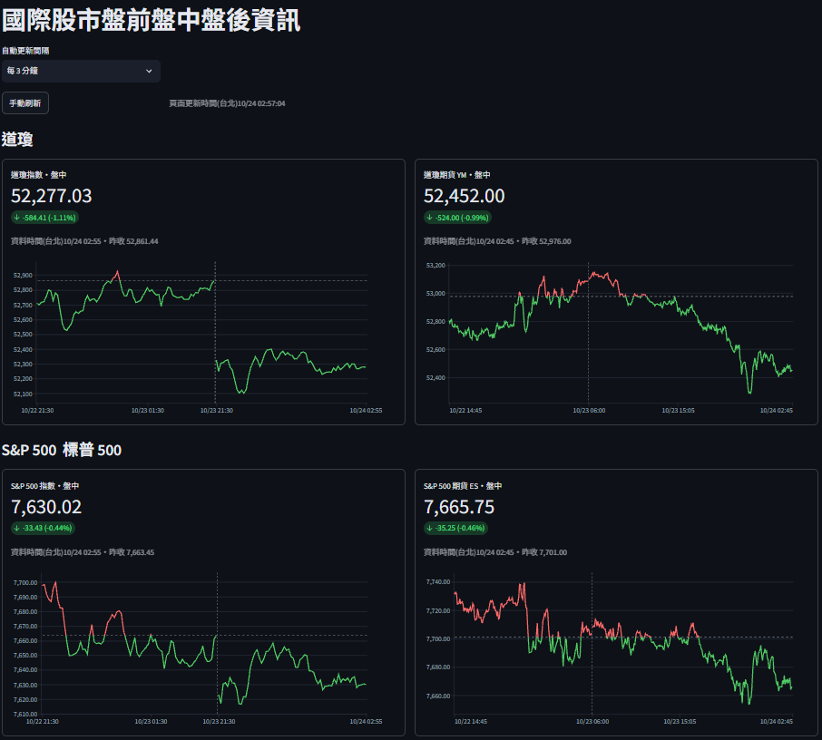
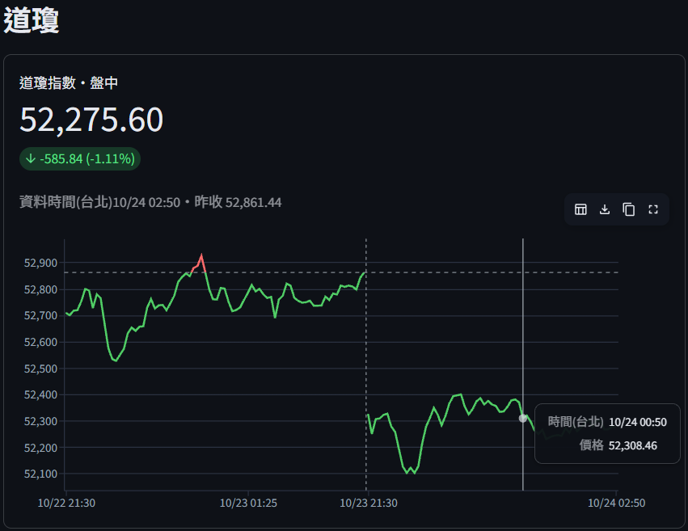
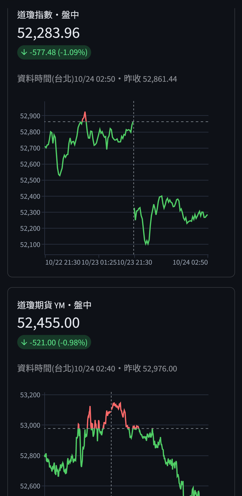

# 國際股市盤前盤中盤後看盤頁

個人使用的看盤頁：道瓊、S&P 500、那斯達克、費半、台積電 ADR(TSM)、比特幣、布蘭特原油。
資料來自 Yahoo Finance(延遲報價)。

## 專案簡介

這個專案是 [tw-stock-selection](https://github.com/chenweiwu213/tw-stock-selection) 的搭配頁面。台股選股工具負責分析台灣市場，而台股常受前一晚美股、期貨、原油與比特幣的走勢影響，所以做了這個頁面，讓使用者在看台股之前，可以快速參考國際市場的狀況。

**設計原因**

- **免費**：資料來自 Yahoo Finance，不需要付費訂閱，也不需要 API key。
- **不使用資料庫**：報價只存在記憶體快取，不寫入任何資料庫，沒有儲存成本，也不會拖累其他專案。
- **獨立部署**：和台股專案分開，Yahoo 資料來源臨時失效時，不會影響台股那邊的功能。

## 畫面預覽

整體畫面(桌面版)：



走勢圖細節：虛線為昨收、休市時段以垂直虛線分隔，游標移上去會顯示時間與價格：



手機版(響應式版面)：



## 功能

- 每張卡片顯示現價、漲跌、時段標籤(盤前／盤中／盤後／夜盤／休市)、資料時間(台北時間)與走勢圖。
- 走勢圖：y 軸不從 0 起算，虛線為昨收；價格高於昨收的線段為紅色、低於昨收的為綠色，穿越昨收處自動換色。
- 走勢圖的休市時段不佔 x 軸，收盤與下次開盤之間以垂直虛線分隔。
- 游標移到圖上會顯示該時間點的時間與價格。
- 自動更新間隔可在頁面上方選 1、3、5 分鐘，也能手動刷新。
- 單一標的抓不到資料時，只有那張卡片顯示「暫時無法取得」，其他卡片不受影響。

## 專案結構

```
market-watch/
├── market_watch.py             # 主程式(資料抓取、時段判斷、卡片與圖表)
├── requirements.txt            # 套件清單(不鎖死 yfinance 版本，Yahoo 改版時重新部署就能拿到修正版)
└── .streamlit/config.toml      # 深色主題(要跟程式一起 push，雲端才會是深色)
```

## 本機測試

建議使用虛擬環境：

```powershell
python -m venv .venv
.\.venv\Scripts\Activate.ps1
pip install -r requirements.txt
python -m streamlit run market_watch.py
```

`.streamlit` 資料夾必須在執行指令的資料夾底下，不然toml沒作用。

## 日後維護

- 卡片全部顯示「暫時無法取得」，可能是 Yahoo 改版導致 yfinance 失效：先到 Streamlit Cloud 的 Manage app 選 Reboot；仍然不行就修改 `requirements.txt` 的 yfinance 版本下限(例如調高一個版本)後 push，觸發重新安裝最新版。

### 新增標的

編輯 `market_watch.py` 最上方的 `SECTIONS`，在對應區塊加一行：

```python
{"name": "顯示名稱", "symbol": "Yahoo 代碼", "kind": "index"}
```

`kind` 可選：

| kind | 用途 |
|---|---|
| `index` | 現貨指數，只有正常盤 |
| `us_future` | 美股指數期貨，近 24 小時交易 |
| `us_equity` | 美股個股或 ETF（含盤前盤後） |
| `always` | 近 24 小時交易的商品（比特幣、原油） |

## 限制

- 指數本身沒有盤前盤後，盤前盤後參考期貨；指數只顯示正常盤(美東 09:30–16:00)，台北時間約 21:30–04:00，冬令時間會晚一小時。
- 時段標籤依美東時間判斷，假日以資料是否超過 60 分鐘沒更新來判斷是否休市。
- 美股期貨每天美東 17:00–18:00 維護休市，走勢圖上會出現一條垂直虛線，屬正常現象。
- 指數本身沒有盤前盤後，盤前盤後請參考期貨；費城半導體指數目前只有正常盤。
- yfinance 是非官方套件，Yahoo 改版時可能暫時失效。
- Yahoo 報價有延遲，盤前盤後成交量薄，價格跳動較大，僅供個人參考。

## 免責聲明

本專案僅供個人研究與學習，所有分析結果不構成任何投資建議，使用者需自行承擔投資風險。

## 授權

本專案以 [MIT License](LICENSE) 授權。

作者：chen wei wu